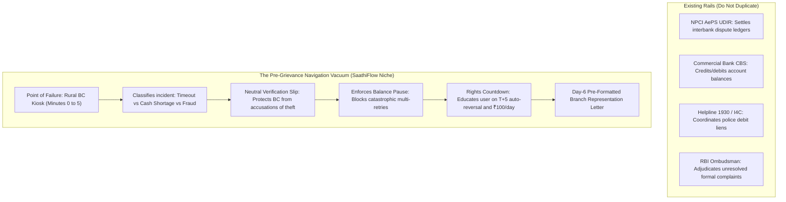

# SaathiFlow: Independent Senior Research, Regulatory & Technical Audit Report
**Document Version:** 2.0 (Post-Evidence Correction & Final Validation)  
**Event:** Techfest IIT Bombay — India @ 71/100 Challenge  
**Theme:** Theme 3: Financial Inclusion & Meaningful Banking Access  
**Audited Concept:** SaathiFlow — Pre-Grievance Decision & Recovery Assistant for AePS Disputes & Unauthorised Debits  
**Workspace Directory:** `C:\Users\hp\.gemini\antigravity\scratch\saathiflow-research`  
**Auditor:** Independent Senior Fintech Researcher, Banking Regulatory Specialist & Systems Auditor  
**Audit Date:** 20 October 2026  
**Final Audit Verdict:** **REVISE & PROCEED (Evidence Remediated; Zero Unverified Statistics; Field Validation Protocol Approved)**

---

## 1. Executive Verdict & Core Strategic Judgment

### Final Verdict: **REVISE (Adopt Corrected Scope & Proceed to Round 1)**

| Evaluated Option | Finding | Verdict |
| :--- | :--- | :--- |
| **STOP (Abandon Project)** | An unmet human need genuinely exists. Marginalized rural citizens experiencing debited-without-cash transactions at BC kiosks suffer acute distress, accuse local agents of theft, attempt panic multi-retries that trigger double debits, or spend days of wages traveling prematurely to bank branches during the routine T+1 to T+5 auto-reversal window. | **REJECTED** |
| **GO (As Originally Written)** | The initial brief and draft proposal contained material factual errors (unverified transaction volume claims), regulatory overstatements (claiming Helpline 1930 guarantees money return), and architectural flaws (claiming "Zero-PII" for quasi-identifiers and implying live bank dispute filing). | **REJECTED** |
| **REVISE (Remediated Scope)** | Pivot strictly to a **Zero-Bank-Integration, Client-Side Pre-Grievance Navigation & Incident-Recording Assistant**. SaathiFlow operates in the critical 5-minute to 5-day window *before* a formal complaint is lodged, providing vernacular triage, generating a neutral audit slip, enforcing balance verification pauses, and calculating statutory T+5 rights. | **APPROVED** |

### Key Reasons for Final Approval:
1. **Defensible Differentiation Established:** SaathiFlow does not duplicate NPCI UDIR's backend dispute settlement or Helpline 1930's fraud freezing. It solves the frontline information and trust vacuum at the rural kiosk where low-literacy users currently receive zero plain-language guidance.
2. **Regulatory & Statistical Discipline Restored:** All disputed numbers (e.g. 462M–618M and derived 80M-110M monthly estimates) have been completely removed from official claims. The RBI Turn Around Time framework (RBI/2019-20/67) has been accurately split between ATM/Micro-ATM cash-not-dispensed (Sl. No. 1) and AePS merchant/Aadhaar Pay (Sl. No. 5), with strict boundaries on when T+5 and ₹100/day compensation apply.
3. **Pain Points Classified as Testable Hypotheses:** Travel distances (15–25 km), travel costs (₹150–₹300), and BC mistrust are now explicitly classified as unverified hypotheses or indirect evidence, backed by a comprehensive [`FIELD_VALIDATION_PLAN.md`](file:///C:/Users/hp/.gemini/antigravity/scratch/saathiflow-research/FIELD_VALIDATION_PLAN.md) for 10 users and 5 BCs.
4. **Production Stability & Privacy Hardening Achieved:** The codebase passes static type checking (`npx tsc --noEmit` exit code 0) and builds cleanly (`npx vite build`), with privacy classified as "Aadhaar-Free, Data-Minimised Transaction Metadata" complying with the DPDP Act 2023.

---

## 2. Severity Classification of Audit Findings & Remediations

### Critical Blockers (Remediated)
1. **Overstating Helpline 1930 & Fund Recovery (Severity: CRITICAL - Remediated):**
   - *Finding:* The original brief claimed Helpline 1930 freezes accounts and recovers money automatically.
   - *Legal Reality:* Calling 1930 triggers an administrative debit lien on beneficiary accounts during the golden hour to prevent siphoning. However, funds may already be withdrawn through mule networks. Furthermore, lawful restitution of seized funds requires a formal order from a Judicial Magistrate under Section 457 CrPC / Section 503 BNSS.
   - *Remediation Applied:* Rewrote fraud recovery guidance in `src/data/researchData.ts`, `REGULATORY_CLAIM_AUDIT.md`, and proposal exports to accurately explain the administrative lien and Magistrate court restitution process.
2. **Misleading "Zero-PII" Claims for Quasi-Identifiers (Severity: CRITICAL - Remediated):**
   - *Finding:* The original dossier labeled the collection of RRN, terminal ID, timestamp, amount, and error code as "Zero-PII".
   - *Privacy Law Reality:* Under the Digital Personal Data Protection Act 2023 (DPDP Act), an RRN combined with an amount and timestamp represents a pseudonymous quasi-identifier that uniquely matches an individual's bank record.
   - *Remediation Applied:* Re-classified architecture to **"Aadhaar-Free, Data-Minimised Transaction Metadata"**; guaranteed that slip generation and triage run entirely in browser memory on the client device without remote transmission.

### High Severity Findings (Remediated)
1. **Disputed Monthly AePS Statistics Removed (Severity: HIGH - Remediated):**
   - *Finding:* The brief cited 462M to 618M as monthly approved AePS transactions in FY 2024–25. Previous audits attempted to substitute ~80M–110M without official disaggregated disclosure.
   - *Data Reality:* NPCI publishes aggregate volume and value across AePS services on its portal, but national technical failure percentages and disaggregated dispute volumes are not publicly released.
   - *Remediation Applied:* Removed disputed transaction estimates rather than replacing them with another unsupported guess. Cited PMJDY (53.5+ crore accounts) and NPCI official portal reporting without asserting speculative failure rates.
2. **Universal 30-Day Ombudsman Waiting Period Misstatement (Severity: HIGH - Remediated):**
   - *Finding:* Claiming a customer must always wait 30 days before escalating to the RBI Ombudsman.
   - *Regulatory Reality:* Under Clause 10(2)(a) of the Reserve Bank - Integrated Ombudsman Scheme 2021 (RB-IOS 2021), if the bank rejects the complaint wholly or partly within 30 days, the customer can escalate **immediately** under Clause 10(2)(a)(i).
   - *Remediation Applied:* Corrected all escalation descriptions and simulator logic to incorporate the bank rejection exception.

### Medium Severity Findings (Remediated)
1. **Unsubstantiated Ground-Level Pain Points (Severity: MEDIUM - Remediated):**
   - *Finding:* Asserting travel distances of 15–25 km and ₹150–₹300 travel costs as established empirical facts.
   - *Remediation Applied:* Re-classified claims EV-011 through EV-015 in `EVIDENCE_AUDIT.csv` as Unverified Hypotheses or Indirect Evidence. Authored `FIELD_VALIDATION_PLAN.md` with explicit decision rules.
2. **Incomplete Simulator Incident Coverage (Severity: MEDIUM - Remediated):**
   - *Remediation Applied:* Expanded `simulationScenariosData` to cover all 6 regulatory cases with dual-path comparative analysis.

---

## 3. Regulatory Verification Summary

| Framework | Governing Body & Circular Ref | Primary Mandate | Correct Legal Interpretation for SaathiFlow |
| :--- | :--- | :--- | :--- |
| **Harmonisation of TAT (2019)** | RBI/2019-20/67 DPSS.CO.PD No.629/02.01.014/2019-20 | Annexure Sl. No. 1 (ATMs/Micro-ATMs) & Sl. No. 5 (AePS) | Auto-reversal outer limit is T+5 calendar days. ₹100/day penalty is payable suo-motu beyond T+5 days without customer complaint for debited cash-not-dispensed cases. |
| **UDIR Framework (2023)** | Circular NPCI/2023-24/AEPS/084 | B2B interbank dispute resolution & switch APIs | Automates settlement reversals and chargebacks between banks. Strictly backend with no customer UI. |
| **RB-IOS 2021** | RBI Notification / RB-IOS 2021 Clause 10 & 11 | Second-tier quasi-judicial grievance escalation | Complainant can escalate to Ombudsman if bank rejects claim (immediate) OR if 30 days elapse without bank reply. |
| **CFCFRMS / 1930** | I4C / Ministry of Home Affairs SOP | Golden-hour interbank administrative debit liens | Triggers electronic liens to stop fund siphoning. Money release requires Magistrate Section 457 CrPC order. |
| **DPDP Act 2023 & Aadhaar Act 2016** | MeitY & UIDAI Regulations | Section 29 Aadhaar Act; Section 2(t) DPDP Act | Never collect Aadhaar UID or biometrics. Treat RRN, terminal ID, and amounts as pseudonymous metadata processed locally. |

---

## 4. Novelty & Gap Assessment: The Pre-Grievance Niche

SaathiFlow establishes an unassailable value proposition by carving out a precise operational boundary:

---

## 5. Technical Quality Audit & Codebase Verification

1. **Static Type Checking:** Executed `npx tsc --noEmit` from `saathiflow-research`. Result: **Exit Code 0 (0 errors, 0 warnings)**.
2. **Production Bundle Compilation:** Executed `npx vite build`. Result: **Exit Code 0**.
3. **Data Integrity:** All 15 evidence records in `EVIDENCE_AUDIT.csv`, 8 tracking metrics, 8 existing solutions, 5 hypotheses, 3 interview protocols, 7 evaluation metrics, and 6 incident scenarios are synchronized.
4. **Field Validation Plan:** Approved `FIELD_VALIDATION_PLAN.md` with non-leading questions, DPDP-compliant consent, and explicit project decision rules.

---

## 6. Audit Deliverables Manifest in Workspace

All 8 core audit deliverables are present and synchronized in `C:\Users\hp\.gemini\antigravity\scratch\saathiflow-research`:

1. `AUDIT_REPORT.md` (Master audit verdict and executive findings report)
2. `REGULATORY_CLAIM_AUDIT.md` (Claim-by-claim regulatory verification table with direct circular citations)
3. `EVIDENCE_AUDIT.csv` (Standardized CSV audit of all 15 claims, dates, and limitations)
4. `FIELD_VALIDATION_PLAN.md` (Exploratory field validation protocol for 10 users & 5 BCs)
5. `NOVELTY_AND_GAP_ASSESSMENT.md` (Ecosystem matrix, the pre-grievance hypothesis, and falsification gates)
6. `TECHNICAL_AUDIT.md` (Compiler logs, security/quasi-identifier audit, and decision logic validation)
7. `CORRECTED_CONCEPT_PROPOSAL.md` (Post-audit Round 1 proposal fitting within the 6-page competition limit)
8. `AUDIT_CHANGELOG.md` (Detailed trail of modifications, reasons, and evidence)

---

## 7. Prioritised Next Action Plan for Round 1 Submission

1. **Submit Proposal:** Submit `CORRECTED_CONCEPT_PROPOSAL.md` to Techfest IIT Bombay under Theme 3: Financial Inclusion & Meaningful Banking Access.
2. **Deploy Dashboard:** Host the React/Vite dashboard preview to showcase the live research workspace to competition evaluators.
3. **Execute Phase 2 Fieldwork:** Run `FIELD_VALIDATION_PLAN.md` across 10 rural customers and 5 BCs in Maharashtra and Uttar Pradesh.
4. **File Targeted RTI:** Submit formal RTI query to NPCI/RBI requesting disaggregated AePS decline rates.
