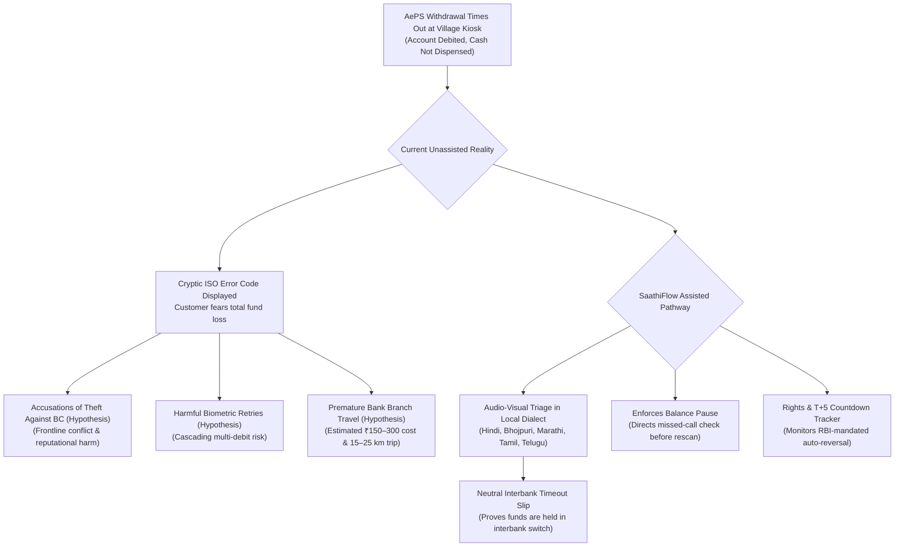
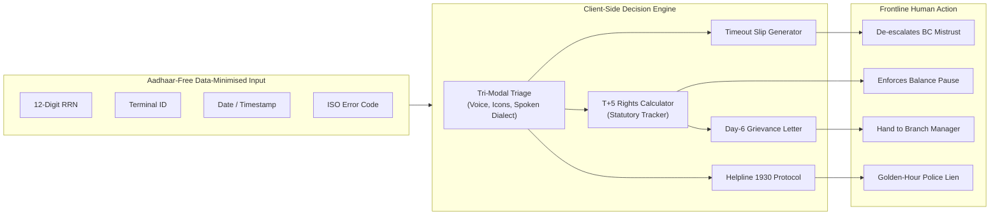

# SaathiFlow: Multilingual Pre-Grievance Decision & Recovery Assistant for AePS Disputes
**Competition Track:** Techfest IIT Bombay — India @ 71/100 Challenge  
**Theme 3:** Financial Inclusion & Meaningful Banking Access  
**Document Type:** Round 1 Concept Proposal (Post-Audit Version 2.0)  
**Date:** 20 October 2026  
**Architecture:** Client-Side, Aadhaar-Free, Data-Minimised Transaction Metadata  
**Page Length:** Formatted to strictly fit within the 6-page competition limit

---

## 1. Executive Summary & Problem Definition

India's Aadhaar Enabled Payment System (AePS) is a vital pillar of rural financial inclusion, providing last-mile banking and cash disbursement for over 53.5 crore Pradhan Mantri Jan Dhan Yojana (PMJDY) account holders (Department of Financial Services, 2024). Operated through Business Correspondents (BCs / Bank Mitras) at village Customer Service Points (CSPs), AePS serves daily-wage earners, women Self-Help Group (SHG) members, and social security pensioners who reside far from commercial bank branches.

While NPCI publishes aggregate transaction statistics across AePS services (cash withdrawal, balance enquiry, mini statement, and Aadhaar Pay) on its official portal, **disaggregated national failure rates and interbank dispute volumes are not publicly reported**. Field reports (MicroSave, Dvara Research) and parliamentary replies confirm that when an AePS cash-out transaction times out—specifically when a customer's account is debited but the micro-ATM fails to dispense cash—a severe information and trust crisis erupts at the village kiosk.

### The Frontline Problem Hypotheses (Under Field Investigation):
1. **Frontline Interpersonal Friction & Agent Security (EV-014):** Micro-ATM terminals display cryptic error codes (e.g., ISO 68 timeout, ISO 91 switch inoperative). Because the customer receives an SMS stating their balance was debited, our working hypothesis posits that customers frequently suspect the BC of pocketing cash, creating severe frontline tension.
2. **Panic Multi-Retries & Cascading Debits (EV-013):** In panic, customers often immediately insist on rescanning their fingerprints 2 to 4 times. In-flight transactions can settle retroactively, creating catastrophic multi-debits that temporarily deplete marginal household liquidity.
3. **Avoidable Branch Travel & Economic Loss (EV-011, EV-012):** Unaware that the Reserve Bank of India mandates an automated T+5 calendar day auto-reversal cycle for failed ATM/micro-ATM withdrawals, rural users travel an estimated 15–25 km to distant bank branches on Day 1 or Day 2, incurring an estimated ₹150–₹300 in travel fares and lost daily wages.
4. **Fraud Golden-Hour Loss (EV-005):** In genuine cases of unauthorized biometric spoofing, rural victims wait days for bank branches to open rather than reporting immediately to the National Cybercrime Helpline 1930 within the critical golden hour.

---

## 2. Regulatory Foundation & Ecosystem Realities

To maintain scientific and regulatory rigor, SaathiFlow acknowledges and builds upon existing Indian digital public infrastructure rather than duplicating it:

1. **Backend Interbank Dispute Settlement Exists (NPCI AePS UDIR):** Under NPCI Circular NPCI/2023-24/AEPS/084 (21 July 2023), member banks interface with NPCI's Unified Dispute and Issue Resolution (UDIR) framework. UDIR automates interbank dispute logging via the `ReqChkTxn` API, managing reversals, credit adjustments, and chargebacks between bank switches. **SaathiFlow does not replicate this backend interbank clearing switch.**
2. **Statutory Customer Protection Exists (RBI TAT Harmonisation):** Under RBI Circular RBI/2019-20/67 (DPSS.CO.PD No.629/02.01.014/2019-20) Annexure Sl. No. 1 (ATMs / Micro-ATMs: Customer's account debited but cash not dispensed) and Sl. No. 5 (AePS merchant acquirer), banks are legally mandated to complete auto-reversals within **T + 5 calendar days** (where T is the transaction date). Beyond T + 5 days, banks must credit compensation of **₹100 per day** of delay suo-motu to the customer's account. (*Scope boundary:* This compensation applies specifically to debited cash-not-dispensed transactions, not to benign declines where no debit occurred).
3. **Quasi-Judicial Escalation Exists (RB-IOS 2021):** Under Clause 10(2)(a) of the Reserve Bank - Integrated Ombudsman Scheme 2021, an aggrieved customer may escalate to the RBI Ombudsman immediately if the bank rejects the complaint (wholly or partly under Clause 10(2)(a)(i)), OR after 30 days if the bank fails to respond.
4. **Law Enforcement Fraud Infrastructure Exists (Helpline 1930 / CFCFRMS):** The Ministry of Home Affairs operates Helpline 1930 and the Citizen Financial Cyber Fraud Reporting and Management System to issue electronic debit liens on suspect recipient bank accounts during the golden hour to halt siphoning. (Crucial legal boundary: Administrative liens do not automatically disburse or refund money back to the victim; formal restitution is subject to judicial or law enforcement verification protocols, such as an application before the jurisdictional Magistrate under Section 503 BNSS / Section 457 CrPC. Calling 1930 never guarantees recovery).

### The Demonstrated Defensible Gap: The "Pre-Grievance Navigation Vacuum"
While backend settlement (UDIR) and second-tier regulatory escalation (RBI Ombudsman) exist, **there is an absolute information void at the village kiosk during the first 5 minutes to 5 days following a transaction failure**. Existing banking grievance portals are English-heavy, text-centric, and assume high digital literacy (Dvara Research, 2023). 

**SaathiFlow fills this specific vacuum: It is an assisted pre-grievance decision and incident-recording assistant that operates at the frontline to calm panic, generate verifiable proof, suppress double-debits, and enforce statutory rights.**

---

## 3. The SaathiFlow Solution Architecture

SaathiFlow is a client-side Progressive Web App (PWA) designed for low-literacy users and Business Correspondents:

### Core Product Capabilities:
1. **Tri-Modal Vernacular Incident Triage:** Uses voice narration and intuitive pictorial icons (traffic-light status cues) in Hindi, Bhojpuri, Marathi, Tamil, Telugu, and English to classify the event into one of 6 distinct incident cases:
   - *Case 1: Cash Not Dispensed, Account Debited (Timeout Failure)*
   - *Case 2: Transaction Pending / Timeout, Debit Status Unknown*
   - *Case 3: Cash Not Dispensed, Account NOT Debited (Benign Terminal Decline)*
   - *Case 4: Unfamiliar Midnight Debit / Suspected Biometric Clone Fraud*
   - *Case 5: Persistent Biometric Authentication Failure (Worn Prints / Sensor Fault)*
   - *Case 6: Complaint Already Filed, Overdue Beyond T+5 Days*
2. **Neutral Interbank Timeout Verification Slip:** Interprets terminal receipt data (12-digit RRN, terminal ID, timestamp, ISO error code) to generate a neutral, bilingual verification slip certifying that funds are held in the interbank switch, directly protecting the BC from false accusations of theft.
3. **Anti-Double Debit "Balance Pause" Protocol:** In timeout scenarios, actively discourages immediate biometric rescanning and guides the customer through a toll-free missed-call balance check before permitting another attempt.
4. **RBI Rights Calculator & Day-6 Escalation Generator:** Displays an interactive visual Day-1 to Day-5 progress countdown. If funds are not credited by Day 6, generates a pre-formatted, vernacular grievance representation citing RBI Circular DPSS.CO.PD No.629/2019-20 and calculating statutory delay compensation (₹100/day).
5. **Immediate Fraud Isolation & 1930 Checklist:** In genuine unauthorized debit scenarios, instantly switches to emergency fraud protocol, triggers Helpline 1930, pre-formats the operator intake details (Bank Name, RRN, Amount, Timestamp), and guides the user through locking Aadhaar biometrics via mAadhaar.

---

## 4. Privacy, Safety & Data-Minimised Architecture

SaathiFlow enforces strict non-interference and regulatory compliance boundaries:

1. **Aadhaar-Free Architecture:** Under Section 29 of the Aadhaar Act 2016 and UIDAI guidelines, SaathiFlow **NEVER** requests, captures, or stores 12-digit Aadhaar UID numbers, biometric fingerprint templates, or iris scans.
2. **Zero Sensitive Banking Credentials:** SaathiFlow **NEVER** collects ATM PINs, MPINs, net-banking passwords, One-Time Passwords (OTPs), or full 16-digit account numbers.
3. **Quasi-Identifier Protection under DPDP Act 2023:** Transaction metadata (RRN, terminal ID, timestamp, amount) are recognized as pseudonymous quasi-identifiers. To guarantee strict privacy, **all processing occurs entirely in browser memory on the client device (PWA)**. There are zero remote network requests, zero cloud database writes, and zero external trackers.
4. **Zero Unauthorised API Claims:** SaathiFlow does not claim to execute real-time fund reversals, freeze bank accounts, or lodge formal police FIRs. All monetary settlements remain strictly with official bank and police rails.

---

## 5. Explicit Research Hypotheses & Falsification Gates

To uphold scientific rigor, SaathiFlow treats its problem definition as hypotheses to be empirically tested via our [`FIELD_VALIDATION_PLAN.md`](file:///C:/Users/hp/.gemini/antigravity/scratch/saathiflow-research/FIELD_VALIDATION_PLAN.md). We emphasize that our planned cohort of 10 users and 5 BCs constitutes an **exploratory qualitative field study**, not a claim of national statistical representation:

| Code | Hypothesis Statement | Supporting Evidence | Contradicting Evidence | Validation Methodology |
| :--- | :--- | :--- | :--- | :--- |
| **H1** | Rural users cannot distinguish routine timeouts from fraud. | Dvara Research (2023) documented severe category confusion in payment interfaces. | BCs may accurately triage incidents verbally. | Scenario comprehension test with 10 rural users. |
| **H2** | Rural users are unaware of T+5 auto-reversal and ₹100/day compensation. | RBI Ombudsman reports show recurring complaints about uncredited penalties. | Banks claim UDIR credits penalties suo-motu. | Survey 10 rural users on rights awareness; audit bank passbooks. |
| **H3** | Lack of neutral slips causes BC friction and panic multi-retries. | BC whitepapers cite physical altercations and multi-debit spikes. | Thermal slips might resolve customer doubts. | Interview 5 active BCs on weekly dispute friction. |
| **H4** *(Falsification)* | Existing bank channels already solve rural dispute needs adequately. | Banks maintain CRCF/CMS portals and branch staff. | Branch visits impose transit costs and lost wages. | Benchmark travel cost and resolution time via standard bank branch vs SaathiFlow. |

### Explicit Falsification Gates (Criteria to Abandon Project):
- **Gate 1:** If > 80% of interviewed rural customers report that their BC already provides clear, trusted failure slips and explanations that eliminate panic.
- **Gate 2:** If bank audits show commercial banks consistently credit ₹100/day penalties suo-motu within 48 hours of delay.
- **Gate 3:** If > 60% of surveyed Business Correspondents refuse to show or print third-party neutral verification slips.

---

## 6. Implementation Roadmap & Usability Evaluation

### 12-Month Phased Implementation Roadmap:
- **Phase 1: Exploratory Field Discovery (Months 1–3):**
  - Execute [`FIELD_VALIDATION_PLAN.md`](file:///C:/Users/hp/.gemini/antigravity/scratch/saathiflow-research/FIELD_VALIDATION_PLAN.md) across 10 rural customers and 5 BCs across 2 districts to qualitatively test hypotheses.
  - Benchmark vernacular audio scripts and test visual icon comprehension.
  - Submit RTI application to NPCI/RBI for disaggregated AePS failure and dispute volumes.
- **Phase 2: Prototype Pilot & Offline PWA (Months 4–6):**
  - Deploy lightweight offline PWA with client-side OCR for thermal slips.
  - Pilot across 50 rural BC kiosks in collaboration with local Lead District Banks or corporate BC aggregators (e.g., PayNearby, CSC).
- **Phase 3: Impact Evaluation & Scale (Months 7–12):**
  - Measure travel reduction, double-debit suppression, and rights awareness against control kiosks.
  - Explore Account Aggregator (AA) framework integration for consent-based balance inquiries if policy permits.

### Target Usability & Impact Metrics (Pre-Pilot Targets, Unvalidated):
*(Note: These represent target benchmarks for prototype evaluation; no claim of actual completed field impact is made prior to Phase 2 trials).*
1. **Correct Next-Step Selection Rate:** Target ≥ 85% correct channel choice (vs. hypothesized < 40% in standard unassisted journeys).
2. **Time to Identify Correct Action:** Target ≤ 90 seconds (vs. > 300 seconds searching menus).
3. **Avoidable Branch Travel Reduction:** Target ≥ 70% reduction in premature branch trips during T+1 to T+5.
4. **Premature Biometric Retry Suppression:** Target ≥ 80% refusal of immediate rescan, preventing double-debits.
5. **Fraud Golden-Hour Compliance:** Target 100% immediate escalation to 1930 without credential sharing.

---

## 7. Primary Annotated References

1. **NPCI (21 July 2023):** *Circular NPCI/2023-24/AEPS/084: UDIR - Enhancing complaint handling and resolution process for AePS transactions.* [NPCI Official Circular](https://www.npci.org.in/PDF/AePS/circular/2023-24/21-July-2023-NPCI-2023-24-AEPS-084-Circular-84-UDIR-Enhancing-complaint-handling-and-resolution-process-for-AePS-transactions.pdf)
2. **Reserve Bank of India (20 Sept 2019):** *Notification RBI/2019-20/67 DPSS.CO.PD No.629/02.01.014/2019-20: Harmonisation of Turn Around Time (TAT) and customer compensation for failed transactions using authorised Payment Systems (Annexure Sl. No. 1 & 5).* [RBI Notification](https://www.rbi.org.in/Scripts/NotificationUser.aspx?Id=11693&Mode=0)
3. **Dvara Research (31 March 2023):** *Do UPI In-App Grievance Redress Mechanisms Work for Constrained Users?* Narayan, A. & Prasad, S. [Dvara Research Report](https://dvararesearch.com/do-upi-in-app-grievance-redress-mechanisms-work-for-constrained-users/)
4. **Reserve Bank of India (12 Nov 2021):** *The Reserve Bank - Integrated Ombudsman Scheme, 2021 (RB-IOS 2021 Clause 10 & 11).* [RBI Publication](https://www.rbi.org.in/Scripts/AnnualReportPublications.aspx?Id=1436)
5. **Ministry of Home Affairs / I4C (2024):** *National Cyber Crime Reporting Portal & Citizen Financial Cyber Fraud Reporting System Standard Operating Procedure.* [Cybercrime Portal](https://cybercrime.gov.in/)
6. **NPCI (2025):** *AePS Monthly Product Statistics FY 2024–25.* [NPCI Product Statistics](https://www.npci.org.in/what-we-do/aeps/product-statistics/2024-25)
7. **Department of Financial Services, Ministry of Finance (2024):** *Pradhan Mantri Jan Dhan Yojana (PMJDY) Scheme Progress Report.* [PMJDY Portal](https://pmjdy.gov.in/scheme)
