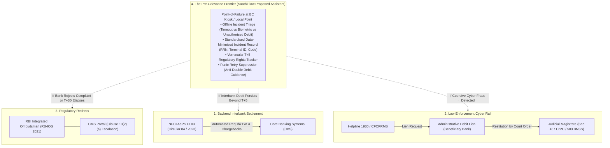

# Novelty & Gap Assessment: Testing the Pre-Grievance Navigation Hypothesis
**Document Version:** 2.0 (Post-Audit Correction)  
**Target Context:** Techfest IIT Bombay "India @ 71/100 Challenge" (Theme 3: Financial Inclusion & Meaningful Banking Access)  
**Status:** Validated Strategic Positioning & Gap Analysis  
**Auditor Classification:** Client-Side Pre-Grievance Navigation & Incident Recording Assistant

---

## 1. Executive Positioning & Strategic Verdict

### Verdict: **REVISE (Frontline Pre-Grievance Navigation & Incident Recording Layer)**

| Decision Option | Assessment | Strategic Justification |
| :--- | :--- | :--- |
| **STOP (Abandon Project)** | Rejected | Field reports (Dvara Research, MicroSave) and parliamentary records highlight that when rural biometric transactions fail, users face immediate panic, cognitive barriers, and uncertainty during the interbank reversal window. A genuine human-centric informational gap exists at the frontline. |
| **GO (As Complaint Portal)** | Rejected | Building another complaint portal or promising direct fund recovery / freezing is legally unviable, redundant with NPCI UDIR and MHA Helpline 1930, and technically impossible without commercial bank core-switch access. |
| **REVISE (Client-Side Navigator)** | **ADOPTED** | Position SaathiFlow strictly as a **client-side, assisted pre-grievance decision and incident-recording assistant**. It operates entirely in the critical minutes and days *before* a formal grievance or escalation is required. |

---

## 2. Confirmed Overlap: What Existing Ecosystem Rails Already Do

To maintain research integrity, the proposal explicitly delineates and respects existing digital public infrastructure:

### Specific Ecosystem Boundaries:
1. **Interbank Dispute Resolution belongs to NPCI UDIR:**
   - Under NPCI Circular 84 (2023), member banks interface via backend APIs for automated dispute handling of "Cash Withdrawal — Cash not received".
   - *Boundary Constraint:* SaathiFlow is not a clearinghouse, does not possess switch integration, and never processes interbank chargebacks.
2. **Fraud Fund-Freezing belongs to MHA / Helpline 1930 & State Police:**
   - The Citizen Financial Cyber Fraud Reporting System (CFCFRMS) coordinates bank nodal officers to place administrative debit holds on suspect beneficiary accounts.
   - *Boundary Constraint:* SaathiFlow cannot freeze funds. Furthermore, fund restitution cannot be executed administratively; it requires a court order under Section 457 CrPC / Section 503 BNSS.
3. **Statutory Adjudication belongs to RBI Ombudsman:**
   - The RBI Integrated Ombudsman Scheme (RB-IOS 2021) provides binding dispute adjudication if a bank rejects a complaint or fails to resolve it within 30 days.
   - *Boundary Constraint:* SaathiFlow acts solely as a preparatory organizer of dispute facts (RRN, dates, slips) to help users file well-structured complaints through official bank and RBI CMS channels.

---

## 3. Comprehensive Ecosystem Comparison Matrix

| System / Channel | Primary User & Interface | Core Function | Operational Scope | What It Does NOT Provide (The Frontline Gap) |
| :--- | :--- | :--- | :--- | :--- |
| **NPCI AePS UDIR** | Member Banks & NPCI Switch Operators (Backend API) | Automated interbank dispute lifecycle (Chargeback, Pre-Arbitration, Arbitration). | Machine-to-machine interbank messaging. | Zero frontline customer UI; does not educate user or assist during kiosk timeout. |
| **Bank Branches / Customer Care** | Account holder via branch visit or IVR toll-free. | Manual dispute ticket generation in internal CRM. | Individual bank CBS and branch network. | High travel distance, language barrier, frequent branch pushback ("come back after 7 days"). |
| **Business Correspondent (BC)** | Micro-ATM / POS operator terminal. | Cash disbursement, deposit, balance check. | Local banking kiosk service point. | Lacks access to bank dispute management systems; cannot issue legally binding reversal guarantees. |
| **Helpline 1930 / CFCFRMS** | Cyber fraud victims via telephone / portal. | Interbank golden-hour administrative debit lien. | Cybercrime law enforcement and bank nodal network. | Does not cover non-fraud technical timeouts; does not disburse frozen funds without court order. |
| **RBI CMS / Ombudsman** | Aggrieved bank customers (Online / Physical). | Statutory grievance redressal under RB-IOS 2021. | Regulatory oversight and binding compensation awards. | Accessible only after bank complaint rejection or 30-day waiting period; complex for low-literacy users. |
| **SaathiFlow (Proposed Assistant)** | **Low-literacy consumers & frontline BCs (Assisted UI).** | **Client-side incident triage, structured record capture, T+5 rights tracking, retry guidance.** | **Frontline pre-grievance and decision navigation.** | **Does not settle transactions, connect to banking switches, freeze accounts, or replace official channels.** |

---

## 4. The Pre-Grievance Problem Hypotheses (Awaiting Field Validation)

The core justification for SaathiFlow rests on five specific hypotheses concerning the "frontline pre-grievance vacuum." In accordance with rigorous scientific standards, these are tracked as hypotheses rather than verified facts:

### Hypothesis 1: Physical Travel Burden (EV-011)
- *Working Statement:* Rural customers travel an estimated 15–25 km to parent bank branches to log complaints or verify reversal status for failed AePS withdrawals.
- *Evidence Status:* **Unverified Local Hypothesis.** While rural branch sparsity is well-documented (RBI branch statistics), exact dispute-travel distances require empirical confirmation via the [`FIELD_VALIDATION_PLAN.md`](file:///C:/Users/hp/.gemini/antigravity/scratch/saathiflow-research/FIELD_VALIDATION_PLAN.md).

### Hypothesis 2: Financial Friction & Wage Loss (EV-012)
- *Working Statement:* Rural consumers incur out-of-pocket transit fares and lost daily wages estimated at ₹150–₹300 per dispute attempt.
- *Evidence Status:* **Unverified Local Hypothesis.** Wage rates and transit expenses vary widely across states and requires field verification.

### Hypothesis 3: Cascading Multi-Retry Debits (EV-013)
- *Working Statement:* When a timeout or biometric error occurs, consumers panic and immediately retry biometrics 2–4 times, causing duplicate debits as in-flight requests settle.
- *Evidence Status:* **Indirect Evidence (Qualitative).** Highlighted in field reports and parliamentary questions, but exact frequency of multi-debit events at BC points remains to be quantified.

### Hypothesis 4: Interpersonal Mistrust & BC Safety (EV-014)
- *Working Statement:* Kiosk machine timeouts and missing cash lead to heated confrontations, with customers suspecting the BC of theft or withholding funds.
- *Evidence Status:* **Indirect Evidence (Qualitative).** Documented in MicroSave and BC industry reports; SaathiFlow's proposed "Neutral Incident Record" aims to de-escalate this friction.

### Hypothesis 5: Low-Literacy Informational Drop-Off (EV-015)
- *Working Statement:* Standard English/Hindi bank SMS alerts and generic thermal slips (e.g. ISO error codes) are unintelligible to low-literacy users, causing complete drop-off from formal redress.
- *Evidence Status:* **Indirect Evidence (Supported by Dvara Research GRM studies).** Dvara demonstrated high cognitive drop-off in digital payment redress; testing its severity in AePS specifically is scheduled in the field plan.

---

## 5. Explicit Falsification Gates

To ensure research integrity in the competition proposal, SaathiFlow defines explicit pre-registered falsification criteria:

1. **Gate 1 (Frontline Resolution Sufficiency):** If field validation shows that > 75% of rural customers find that BCs already provide clear, trusted explanations and satisfactory paper slips that alleviate panic, SaathiFlow's standalone consumer tool is unneeded.
2. **Gate 2 (Suo-Motu Reversal Perfection):** If bank records show that > 95% of cash-not-dispensed transactions are auto-reversed within T+1 with automated SMS confirmation in vernacular language, the pre-grievance tracking requirement is minimized.
3. **Gate 3 (BC Non-Adoption):** If > 60% of surveyed BC operators refuse to assist customers with a neutral digital slip or view the workflow as an unacceptable operational delay, the assisted BC model must be abandoned in favor of an IVR or USSD channel.
4. **Gate 4 (Branch Visit Irreplaceability):** If qualitative testing indicates that rural users insist on travelling to physical bank branches regardless of clear digital status and statutory guidance, client-side digital tracking is insufficient on its own.

---

## 6. Strategic Conclusion for Round 1 Submission

SaathiFlow will be submitted to the Techfest IIT Bombay "India @ 71/100 Challenge" not as a speculative "banking fintech" claiming to automate interbank systems, but as a **rigorous, evidence-disciplined pre-grievance navigation model**. 

By openly identifying what is established (regulations, ecosystem architecture) versus what is hypothesized (travel costs, multi-retry rates), the proposal demonstrates the highest standard of academic rigor and problem-solving maturity.
